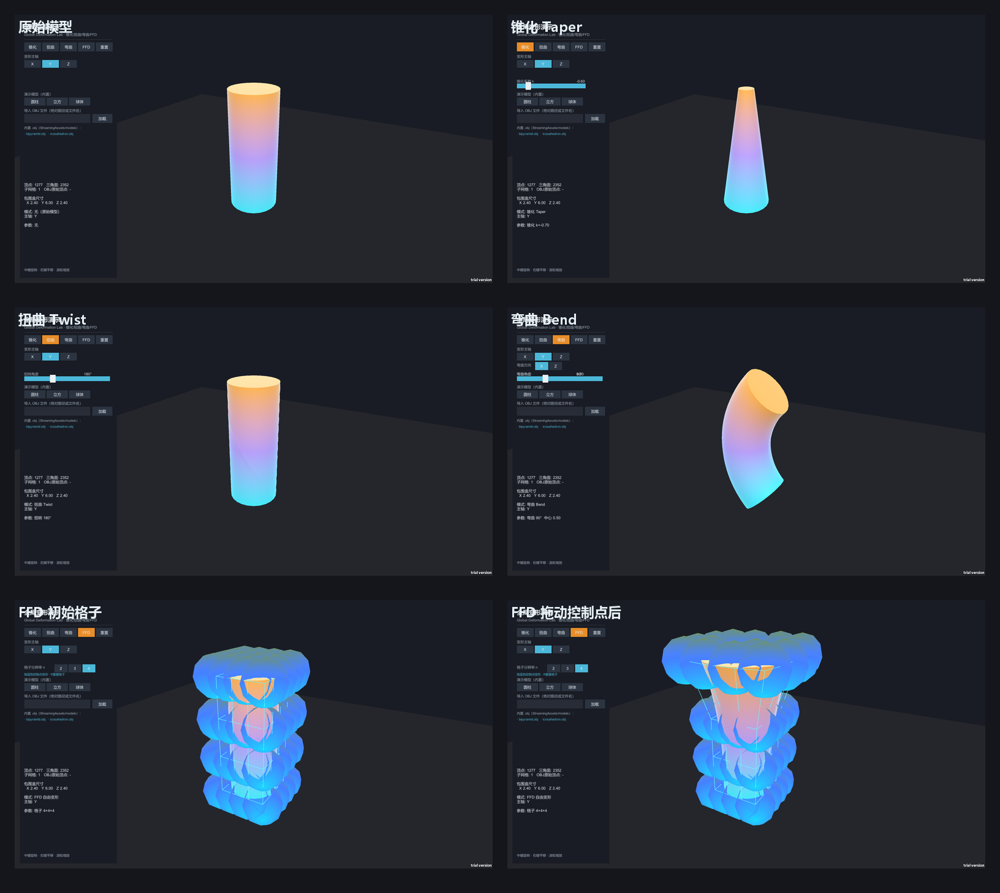

# DeformationLab · 全局变形演示（锥化 / 扭曲 / 弯曲 / FFD）

> 课程作业：在其他编程环境下实现「全局变换（Global Deformation）演示程序」（本工程用 Unity）
> 作者：朱胤合　学号：202411581462
> 引擎：Unity 2022.3.62f3c1 · Built-in Render Pipeline · C#

一个用 Unity 实现、可**导入 OBJ 模型**、通过**按钮选择变形**的交互式演示：内置 **锥化（Taper）、扭曲（Twist）、弯曲（Bend）** 三种解析式全局变形，以及 **FFD（Free-Form Deformation）自由变形**，并用手写数学库 + 数值自检保证变形公式的正确性。



---

## 一、这个程序做了什么

打开程序（或按 Play）后，自动加载一个**细长圆柱**作为默认演示模型（自带青→紫→橙高度渐变，变形后一眼能看出"原来哪一段被移到了哪里"）。左侧面板点按钮即可切换变形：

| 变形 | 原理 | 可调参数 |
|---|---|---|
| **锥化 Taper** | 垂直主轴的平面内，缩放系数 `s = 1 + k·t` 随高度线性变化 | 锥化系数 k（-1 ~ 1） |
| **扭曲 Twist** | 绕主轴旋转，角度 `θ = angle·t` 随高度线性累计 | 扭转角度（0° ~ 360°） |
| **弯曲 Bend** | 把直线主轴映射到圆弧，弯曲角沿主轴线性累计 | 弯曲角度、弯曲中心、弯曲方向 |
| **FFD** | n×n×n 控制点格子 + Bernstein 张量积（Sederberg-Parry） | 格子分辨率 n（2/3/4）、直接拖动控制点 |

四种变形都能选**主轴 X / Y / Z**；FFD 模式下可以**鼠标直接拖动**蓝色控制点球，模型实时跟随变形。

**作业要求逐条对应：**

| 作业要求 | 实现 |
|---|---|
| 能够导入 obj 文件 | 运行时自写 OBJ 解析器（`ObjParsing.cs`），UI 输入绝对路径或文件名即可加载；内置 `bipyramid.obj` / `icosahedron.obj` 两个示例 |
| 能够选择变形按钮 | 左侧面板「锥化 / 扭曲 / 弯曲 / FFD / 重置」五个按钮 |
| 实现锥化 / 扭曲 / 弯曲 | `DeformMath.cs` 里三个纯函数，数学自检逐项验证 |
| FFD 初始状态：算包围框 → n×n×n 网格点 | `FfdLattice.Build()` 按包围盒均匀摆放 n³ 个控制点 |
| FFD 终止状态：改网格点 → 看模型变化 | 拖动控制点 → `FfdLattice.Deform()` 用 Bernstein 重算全部顶点 |

---

## 二、核心算法

### 1. 三种解析式全局变形（Barr 1984）

统一用「主轴归一化参数」`t ∈ [0,1]`（顶点在主轴方向、相对包围盒的位置）：

```
t = (p[axis] − min[axis]) / (max[axis] − min[axis])
```

| 变形 | 公式 |
|---|---|
| **Taper** | `s(t) = 1 + k·t`，垂直主轴的两个坐标相对中心线缩放：`p'[c] = center[c] + (p[c]−center[c])·s` |
| **Twist** | `θ(t) = angle·t`，绕主轴旋转：`p' = center + R(axis, θ)·(p − center)` |
| **Bend** | `R = H/θ`（弯曲半径），`s = p[axis] − yc`（弧长），`φ = s/R`，`off = p[bendDir] − cDir`，则 `new(bendDir) = R(1−cosφ) + off·cosφ`，`new(axis) = yc + R·sinφ − off·sinφ` |

三种都是**纯函数**：输入原始顶点 + 包围盒 + 参数 → 输出新顶点，每次从 `restVertices`（初始顶点）出发计算，**反复切换不会累积误差**。

### 2. FFD 自由变形（Sederberg & Parry 1986）

```
① 初始状态：包围盒 [min,max] → n×n×n 个均匀控制点
     P[i,j,k] = min + (i/(n-1))·dx + (j/(n-1))·dy + (k/(n-1))·dz

② 嵌入：每个顶点 v 换算成格子里的参数坐标（初始格子均匀 = 线性归一化）
     s = (v.x − min.x)/dx，t = (v.y − min.y)/dy，u = (v.z − min.z)/dz

③ 变形：顶点新位置 = 控制点的 Bernstein 张量积
     v' = Σᵢ Σⱼ Σₖ Bᵢ(s)·Bⱼ(t)·Bₖ(u) · P[i,j,k]

④ 终止状态：拖动 P[i,j,k] → v' 随之改变
     （顶点的 (s,t,u) 在嵌入后【永不改变】，它"粘"在参数空间里）
```

其中 `Bᵢ(u) = C(m,i)·uⁱ·(1−u)^(m−i)` 是 Bernstein 基函数（`m = n−1` 为次数）。`n=2` 是三线性插值，`n=4` 是最经典的三次 FFD。

**关键点**：FFD 与"直接拖顶点"的本质区别——顶点不直接被改，而是通过 Bernstein 权重"跟随"控制点移动。这是自由变形的核心思想，代码里 `FfdLattice.Embed()`（嵌入）与 `FfdLattice.Deform()`（重建）完全分离。

---

## 三、怎么运行

### 方式 A：直接跑编译好的 exe

```
DeformationLab_Build/DeformationLab.exe   （双击即可，无需装 Unity）
```

### 方式 B：用 Unity 打开工程

1. Unity Hub → **Add project from disk** → 选择本目录（推荐 Unity **2022.3.62f3c1**）；
2. 打开场景 `Assets/Scenes/DeformationLab.unity`；
3. 按 **▶ Play**（相机、灯光、模型、UI 全部运行时自动生成，编辑器里不播放时是空场景）。

> 菜单 `全局变形作业 → 1. 重建场景` 可一键重建整个场景。

### 操作

| 操作 | 功能 |
|---|---|
| 左侧按钮 | 锥化 / 扭曲 / 弯曲 / FFD / 重置 |
| 主轴 X / Y / Z | 选择变形主轴 |
| 参数滑块 | 锥化系数 / 扭转角度 / 弯曲角度 / 弯曲中心 |
| 中键拖拽 | 旋转视角 |
| 右键拖拽 | 平移视角 |
| 滚轮 | 缩放 |
| FFD 模式下拖拽蓝色控制点球 | 移动控制点，模型实时变形 |
| FFD 模式按 `R` | 重置格子 |

---

## 四、目录结构

```
DeformationLab/
├── Assets/
│   ├── Scripts/
│   │   ├── Runtime/
│   │   │   ├── ObjParsing.cs            ← 自写 OBJ/MTL 解析器（复用自 ObjViewer）
│   │   │   ├── ObjMeshBuilder.cs        ← ObjData → Unity Mesh
│   │   │   ├── DeformMath.cs            ← ★ Taper/Twist/Bend 三个变形纯函数
│   │   │   ├── FfdLattice.cs            ← ★ FFD 格子：嵌入 + Bernstein 张量积
│   │   │   ├── DeformableModel.cs       ← ★ 可变形模型：加载/顶点访问/变形基准
│   │   │   ├── ProceduralMeshBuilder.cs ← 内置演示模型（圆柱/立方/球）
│   │   │   ├── DeformationController.cs ← 主控制器：模式/参数/变形编排
│   │   │   ├── DeformationFactory.cs    ← 场景/控制点/格子线框工厂
│   │   │   ├── DeformationInteraction.cs← 轨道相机 + FFD 控制点拾取拖拽
│   │   │   ├── DeformationUI.cs         ← 代码搭 UGUI + 逻辑
│   │   │   └── DevAutoShot.cs           ← 命令行自动截图（验收）
│   │   └── Editor/
│   │       ├── DeformationTools.cs      ← 重建场景/审计/构建
│   │       └── DeformSelfTest.cs        ← 17 项数学自检
│   ├── Shaders/
│   │   ├── SurfaceLambert.shader        ← 模型着色（顶点色 + 半兰伯特 + 边缘光）
│   │   └── Unlit.shader                 ← 地面/控制点/线框着色
│   ├── StreamingAssets/models/          ← 演示 OBJ（bipyramid / icosahedron）
│   └── Scenes/DeformationLab.unity
├── docs/
│   ├── 全局变形教程.md                  ← ★ 从零学会四种变形的教程
│   ├── 验收截图/                        ← 6 张运行截图 + 总览图
│   ├── 数学自检报告.txt
│   └── 构建报告.txt
├── tools/                               ← 生成演示 OBJ / 拼总览图 的脚本
└── README.md
```

---

## 五、数学自检（17 项，全部通过）

程序内菜单 `全局变形作业 → 4. 数学自检`，或看 [docs/数学自检报告.txt](docs/数学自检报告.txt)：

| 变形 | 检验项 |
|---|---|
| Taper | k=0 恒等 · 主轴不变 + 垂直轴缩放正确 · 中心线不动 · 顶部偏离顶点放大 |
| Twist | angle=0 恒等 · 顶部转满角、底部不转 · 与 Unity Quaternion 逐项对拍一致 |
| Bend | θ=0 恒等 · 中心线顶点落圆弧 · 顶部弧角 = π/4 · z 坐标不变 |
| FFD | 初始格子重建=恒等（嵌入无损）· Bernstein 单位分解 ΣB=1 · 线性精度 · 移动角点→顶点按 Bernstein 跟随 · Reset 恢复恒等 |

**结果：17 通过 / 0 失败**，证明手写的变形公式与数学定义、Unity 引擎一致。

---

## 六、验收记录

| 项目 | 结果 |
|---|---|
| 编译 | 0 错误 0 警告 |
| 构建 | Succeeded，67.3 MB（Windows x64） |
| 数学自检 | **17/17 通过** |
| 运行验证 | 6 张截图（原始/锥化/扭曲/弯曲/FFD初始/FFD变形）逐张目视核对通过 |

截图见 `docs/验收截图/`。

---

## 七、说明

- 本工程复用了 [ObjViewer](https://github.com/flaglermullins922-hash/unity-runtime-obj-viewer) 的 OBJ 解析器（`ObjParsing.cs` / `ObjMeshBuilder.cs`），把命名空间改为 `DeformationLab`。
- 演示 OBJ（`bipyramid.obj` / `icosahedron.obj`）由 `tools/generate_demo_obj.py` 程序化生成，无版权问题。
- 工程不含 `Library/` 等 Unity 生成目录（见 `.gitignore`），克隆后用 Unity 2022.3.62 打开即可。
